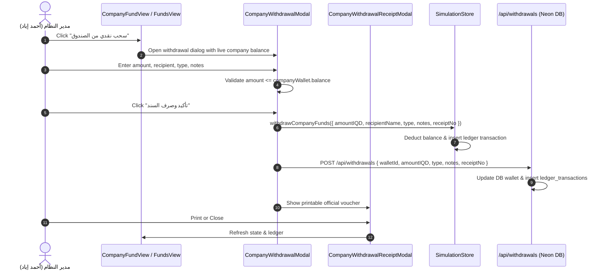

# Design Specification: Company Fund Cash Withdrawal & Dedicated Treasury Hub

**Date:** 2026-10-04  
**Project:** نظام أمان للتقسيط - سامراء (Aman Installments System)  
**Status:** Approved  

---

## 1. Executive Summary

This feature adds an official cash withdrawal mechanism from the Company Fund (صندوق نظام أمان الرئيسي) and introduces a dedicated high-priority navigation tab: **"صندوق الشركة" (Company Treasury Hub)**. It gives system administrators full visibility and control over all cash movements, deposits, withdrawals, direct revenues, and installment earnings belonging to the company fund, complete with official printable disbursement vouchers (سندات صرف رسمية).

---

## 2. Core Requirements

1. **Company Fund Cash Withdrawal Engine (`withdrawCompanyFunds`)**:
   - Validate that the requested withdrawal amount does not exceed available cash liquidity in the company wallet (`this.companyWallet.balance`).
   - Deduct the amount safely from `this.companyWallet.balance`.
   - Maintain synchronization across `store.wallets` where `w.id === this.companyWallet.id` or `w.ownerType === 'COMPANY'`.
   - Generate a chronological, unique receipt voucher number (e.g. `WTH-COMP-YYYY-XXX`).
   - Create a corresponding `LedgerTransaction` entry (`type: 'WITHDRAWAL'`) recording the recipient's name, notes, purpose, and timestamp.
   - Synchronize with the Neon PostgreSQL database via `/api/withdrawals`.

2. **Dedicated Sidebar Tab ("صندوق الشركة")**:
   - Add `company_fund` to `ActiveTab` in Sidebar.tsx.
   - Use the `Landmark` icon with emerald theme styling.
   - Guarded by existing `FUNDS_MANAGE` and `DASHBOARD_VIEW` permissions.

3. **Dedicated Company Treasury View (`CompanyFundView.tsx`)**:
   - **Hero Financial KPI Cards**:
     - Current Available Liquidity in Company Fund (with privacy toggle).
     - Total Cash Withdrawals executed from Company Fund.
     - Total Capital Deposits / Injections into Company Fund.
     - Total Net Company Profits (Repayment profits + Direct revenues).
   - **Quick Action Center**:
     - "سحب نقدي من الصندوق" (Cash Withdrawal Modal trigger).
     - "إيداع وتغذية الصندوق" (Deposit Capital Modal trigger).
     - "تسجيل إيراد مباشر / عمولة" (Direct Revenue trigger).
     - "طباعة كشف حساب الخزينة" (Print Account Statement).
   - **Comprehensive Company Fund Ledger**:
     - Filterable, searchable table displaying every incoming and outgoing transaction touching the company wallet.
     - Running balance calculation (الرصيد اللحظي).
     - Action to view and print official voucher for any transaction.

4. **Official Disbursement Voucher Modal (`CompanyWithdrawalModal.tsx` & `CompanyWithdrawalReceiptModal.tsx`)**:
   - Form fields:
     - Amount in Iraqi Dinars (with live validation against available liquidity).
     - Automatic Arabic number-to-words conversion (`tafqeetIQD`).
     - Recipient name (e.g., المدير العام, الشريك, المفوض).
     - Withdrawal category (سحب أرباح متحققة, سحب سيولة عامة, مصاريف ونفقات مالية خاصة).
     - Statement / Purpose of withdrawal.
     - Sequential receipt voucher number.
   - Official printable voucher (A4 / Thermal):
     - Company branding ("نظام أمان للتقسيط - سامراء").
     - Details, recipient, amount in figures and words, date, signatures (أمين الصندوق, المدير العام, توقيع المستلم).

5. **Cross-View Accessibility**:
   - In FundsView.tsx, add a direct "سحب نقدي من الصندوق" action button on the Company Wallet card.
   - In InvestorsView.tsx, allow quick jumping to the company fund management.

---

## 3. Architecture & Data Flow

---

## 4. Verification & Testing Strategy

- Unit tests in `src/tests/company_fund.test.ts`:
  - Verify `withdrawCompanyFunds` validates insufficient balance.
  - Verify balance deduction is exact and synchronized.
  - Verify ledger transaction fields, receipt number, and recipient formatting.
  - Verify integration with `SimulationStore` ledger filters.
- Run `npx tsx --test src/tests/*.test.ts` to ensure 100% passes with zero regressions.
- Run Next.js lint / typecheck to ensure zero TypeScript errors.
