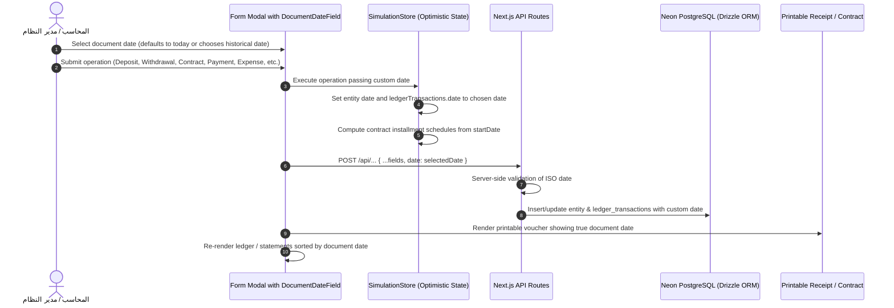

# Design Specification: Document Dates & Historical Financial Backdating

**Date:** 2026-10-06  
**Project:** نظام أمان للتقسيط - سامراء (Aman Installments System)  
**Status:** Approved  

---

## 1. Executive Summary

This feature adds a unified **Document Date (تاريخ المستند المالي)** capability across all financial workflows and operations in the Aman Finance System. By default, every operation defaults to the current date (`YYYY-MM-DD`). However, operators and administrators can now record historical documents (e.g. contracts signed last week, installment payments collected days earlier, past purchases, or historical capital injections/withdrawals). The system accurately schedules future installments based on the actual contract date, maintains chronological accounting ledgers, and synchronizes the real document date to the Neon PostgreSQL database and official printable vouchers.

---

## 2. Scope & Core Requirements

1. **Unified UI Date Control (`DocumentDateField.tsx`)**:
   - Reusable component placed in `src/components/common/DocumentDateField.tsx`.
   - Defaults to today's date formatted as `YYYY-MM-DD`.
   - Native HTML5 date input with calendar trigger icon.
   - Quick action button `اليوم` to reset back to today.
   - Non-intrusive contextual badge/hint when an older date is picked: *(مستند بأثر رجعي: سيتم تقييد القيد واحتساب الحركات بتاريخ YYYY-MM-DD)*.
   - Required / disabled states and RTL-friendly layout.

2. **Full Operation Coverage**:
   - **Capital Deposits (إيداع رأس مال)**: In `FundsView.tsx`, `CompanyFundView.tsx`, and `InvestorStatementModal.tsx`.
   - **Cash Withdrawals (سحب أموال)**: In `CompanyWithdrawalModal.tsx` and investor withdrawal in `InvestorsView.tsx`.
   - **Investor Onboarding (تسجيل مستثمر)**: In `InvestorsView.tsx`, recording initial capital deposit date.
   - **Installment Contracts (عقود التقسيط)**: In `InvoicesView.tsx` and `BorrowersView.tsx` (`CreateContractModal`).
   - **Installment Collections (تسديد وقبض الأقساط)**: When marking an installment schedule as paid in `BorrowersView.tsx` and `InvoicesView.tsx`.
   - **Direct Debts (دفتر الديون المباشرة)**: In `DebtLedgerView.tsx` for creating direct debts and paying installments.
   - **Inventory Purchases (توريد وشراء بضائع للمخزن)**: In `InventoryView.tsx`.
   - **Operational Expenses (المصاريف التشغيلية)**: In `ExpensesView.tsx`.
   - **Revenues (الإيرادات المتنوعة)**: In `RevenuesView.tsx`.
   - **Official Vouchers & Receipts**: Printed documents (`DepositReceiptModal`, `CompanyWithdrawalReceiptModal`, `ContractDocumentHubModal`) reflect the true document date.

3. **Accounting & Schedule Engine (`SimulationStore`)**:
   - Every mutation accepts an optional `date?: string` parameter:
     - `depositCapital({ walletId, amountIQD, notes, date })`
     - `withdrawInvestorFunds({ investorId, amountIQD, type, notes, receiptNo, date })`
     - `withdrawCompanyFunds({ amountIQD, recipientName, type, notes, receiptNo, date })`
     - `createContract({ borrowerId, inventoryItemId, totalSalePriceIQD, downPaymentIQD, monthsCount, startDate })`
     - `payInstallmentSchedule(contractId, scheduleId, customPaidAmountIQD, paymentDate)`
     - `addDirectDebt({ ..., startDate })`
     - `payDirectDebtSchedule(contractId, scheduleId, customPaidAmountIQD, paymentDate)`
     - `purchaseInventory({ ..., purchaseDate })`
     - `addExpense({ ..., date })`
     - `addRevenue({ ..., date })`
     - `addInvestor({ ..., date })`
   - When creating installment contracts with a past `startDate`:
     - Schedules have `dueDate` calculated relative to the contract's `startDate` (`startDate + i months`).
     - Down payment transaction (if present) is timestamped with `startDate`.
   - When paying installments:
     - `paidDate` on the schedule item and `date` on the `PAYMENT_RECEIVED` transaction are set to `paymentDate || today`.
   - Financial journals, ledger tables, and reports sort chronologically based on `new Date(tx.date)`.

4. **API & Database Persistence (Neon PostgreSQL / Drizzle ORM)**:
   - Synchronize the custom date to database tables and `ledger_transactions`:
     - `/api/deposits`: accepts `date` -> sets `ledgerTransactions.date`.
     - `/api/withdrawals`: accepts `date` -> sets `ledgerTransactions.date`.
     - `/api/contracts`: accepts `startDate` -> sets `installmentContracts.startDate` and computes `installmentSchedules.dueDate`.
     - `/api/installments/pay`: accepts `paidDate` -> sets `installmentSchedules.paidDate` and `ledgerTransactions.date`.
     - `/api/direct-debts`: accepts `startDate` -> sets `directDebts.startDate` and schedule due dates.
     - `/api/direct-debts/pay`: accepts `paidDate` -> sets `directDebtSchedules.paidDate` and `ledgerTransactions.date`.
     - `/api/inventory`: accepts `purchaseDate` -> sets `inventoryItems.purchaseDate` and `ledgerTransactions.date`.
     - `/api/investors`: accepts `date` -> sets initial capital `ledgerTransactions.date`.
     - `/api/expenses`: accepts `date` -> sets `expenses.date` and `ledgerTransactions.date`.

---

## 3. Architecture & Data Flow



---

## 4. Component Interface

```typescript
// src/components/common/DocumentDateField.tsx
export interface DocumentDateFieldProps {
  value: string; // YYYY-MM-DD
  onChange: (value: string) => void;
  label?: string; // Default: 'تاريخ المستند'
  required?: boolean;
  disabled?: boolean;
  className?: string;
  helperText?: string;
  maxDate?: string; // Default: undefined (allows future if needed, usually today or open)
}
```

---

## 5. Verification & Testing Strategy

1. **Automated Unit Tests (`src/tests/document_dates.test.ts`)**:
   - Verify `depositCapital` with a historical date stamps `LedgerTransaction.date` correctly.
   - Verify `withdrawCompanyFunds` and `withdrawInvestorFunds` preserve historical dates.
   - Verify `createContract` calculates monthly schedule `dueDate` based on custom `startDate` (e.g. from 2026-01-15).
   - Verify `payInstallmentSchedule` records custom `paymentDate` on schedule and transaction.
   - Verify `purchaseInventory`, `addExpense`, `addRevenue`, and `addDirectDebt` respect custom dates.
   - Verify ledger transactions sort chronologically.
2. **Build & Toolchain Health**:
   - Run `npx tsx --test src/tests/*.test.ts` to verify all tests pass.
   - Run `npm run lint` or `npx tsc --noEmit` to ensure zero TypeScript errors.
